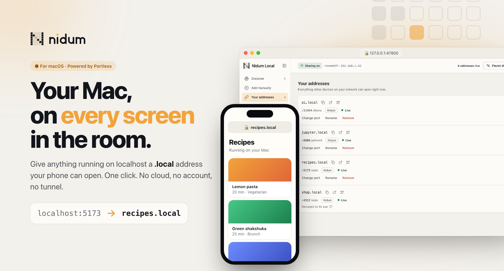
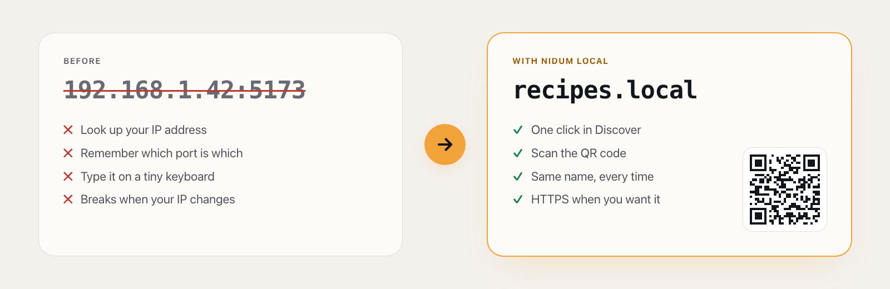
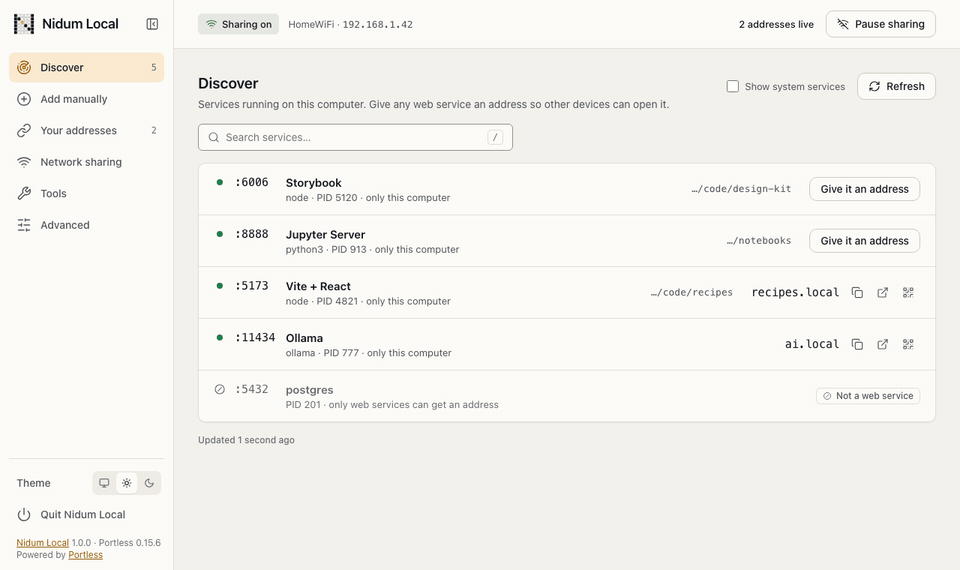
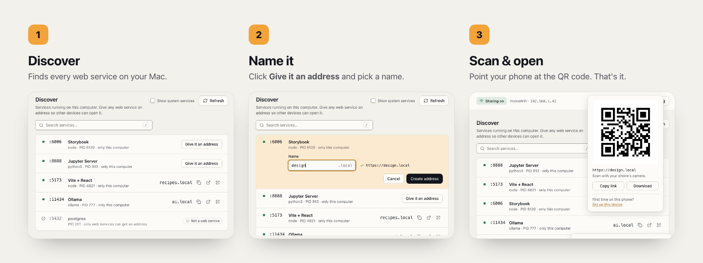
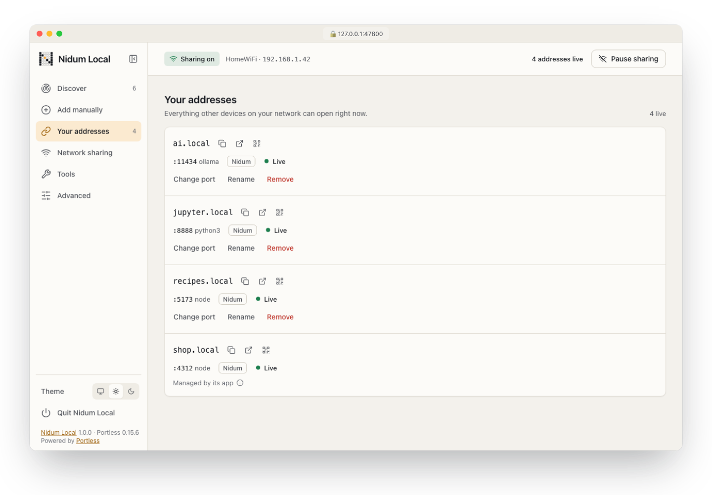
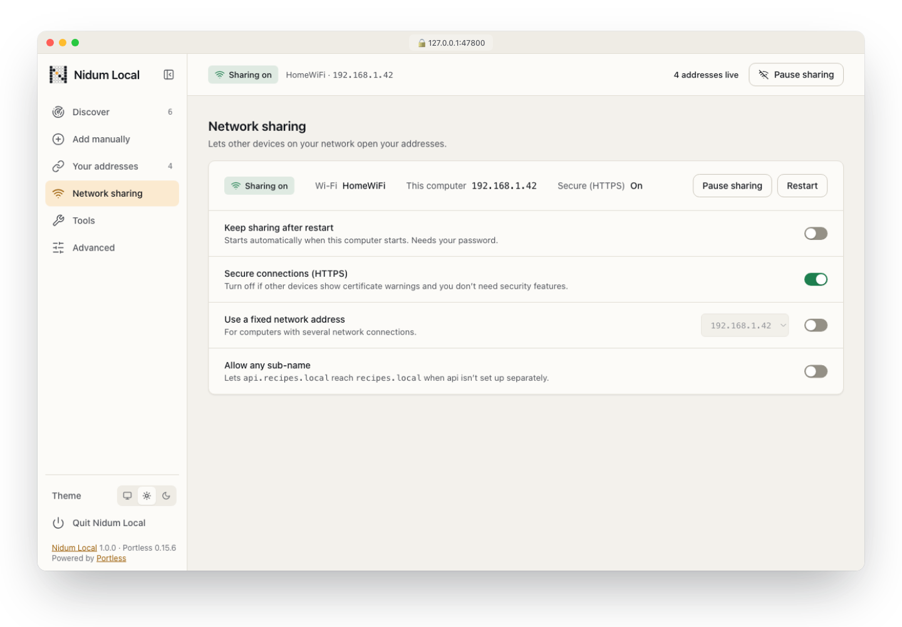
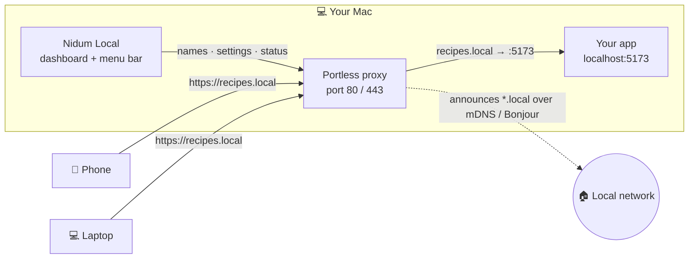
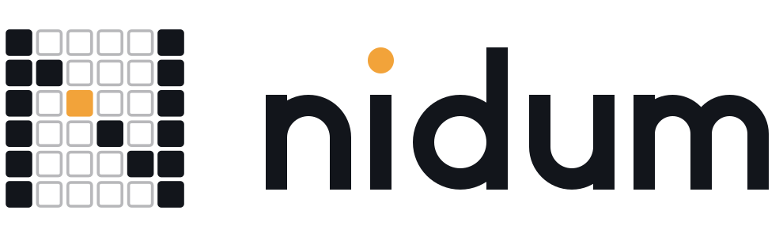

<div align="center">

<picture>
  <source media="(prefers-color-scheme: dark)" srcset="assets/readme/hero-dark.png">
  
</picture>

<br>

[](#-quick-start)
[](https://nodejs.org)
[](https://github.com/vercel-labs/portless)
[](LICENSE)

[](package.json)
[](#%EF%B8%8F-privacy-and-security)
[](#%EF%B8%8F-development)
[](https://nidum.ai)

**[Quick start](#-quick-start)** · **[See it work](#-see-it-in-action)** · **[Features](#-features)** · **[How it works](#-how-it-works)** · **[For teams](#-nidum-for-your-company)** · **[Development](#%EF%B8%8F-development)**

</div>

<br>

> **You're running something great on your Mac**: a Vite app, a Jupyter notebook, a local AI model, a Storybook. **Nidum Local gives it a name your phone can open.** No IP addresses, no port numbers, no cloud, no tunnel. Just `recipes.local`, and a QR code to scan.

<br>

<div align="center">
<picture>
  <source media="(prefers-color-scheme: dark)" srcset="assets/readme/ba-dark.png">
  
</picture>
</div>

## 🎬 See it in action

<div align="center">
<picture>
  <source media="(prefers-color-scheme: dark)" srcset="assets/readme/demo-dark.gif">
  
</picture>
<br>
<sub><i>Discover → Give it an address → scan. Recorded from the real dashboard.</i></sub>
</div>

<br>

<div align="center">
<picture>
  <source media="(prefers-color-scheme: dark)" srcset="assets/readme/flow-dark.png">
  
</picture>
</div>

## ✨ Features

<table>
  <tr>
    <td width="33%" valign="top">
      <h3>🔎 Discover</h3>
      Sees every service listening on your Mac, knows which ones are web apps, and names them for you: Storybook, Vite + React, Jupyter, Ollama…
    </td>
    <td width="33%" valign="top">
      <h3>🏷️ One-click names</h3>
      <b>Give it an address</b> turns <code>:5173</code> into <code>recipes.local</code>. Or add any port by hand.
    </td>
    <td width="33%" valign="top">
      <h3>📱 QR codes</h3>
      Every address has a QR code, so opening it on a phone is point-and-tap.
    </td>
  </tr>
  <tr>
    <td valign="top">
      <h3>🟢 Live status</h3>
      Each address shows whether its app is up, starting or stopped. It even spots Vite's <code>allowedHosts</code> block and tells you the fix.
    </td>
    <td valign="top">
      <h3>🔒 HTTPS</h3>
      Secure <code>.local</code> addresses, plus guided setup for phones and other computers.
    </td>
    <td valign="top">
      <h3>⏸️ Pause and resume</h3>
      Take everything offline in one click, and bring it back just as fast.
    </td>
  </tr>
  <tr>
    <td valign="top">
      <h3>🔁 Survives restarts</h3>
      Optionally keep sharing after a reboot, as a startup service.
    </td>
    <td valign="top">
      <h3>🧭 Network-aware</h3>
      Shows your Wi-Fi or Ethernet, warns on public networks, and can pin a fixed network address.
    </td>
    <td valign="top">
      <h3>🩺 Plain-language fixes</h3>
      When something's wrong, it says what happened and what to do, with copy-ready commands.
    </td>
  </tr>
  <tr>
    <td valign="top">
      <h3>🍎 Menu bar app</h3>
      Open Dashboard, Stop All Services, Quit: always one click away.
    </td>
    <td valign="top">
      <h3>🌗 Light and dark</h3>
      Follows your system, or pick one. Every screen is designed for both.
    </td>
    <td valign="top">
      <h3>📦 Zero dependencies</h3>
      Plain Node.js and ES modules. No npm install, no build step.
    </td>
  </tr>
</table>

<div align="center">
<table>
  <tr>
    <td width="50%" align="center">
      <picture>
        <source media="(prefers-color-scheme: dark)" srcset="assets/readme/addresses-framed-dark.png">
        
      </picture>
      <b>Your addresses</b>: what other devices can open right now
    </td>
    <td width="50%" align="center">
      <picture>
        <source media="(prefers-color-scheme: dark)" srcset="assets/readme/sharing-framed-dark.png">
        
      </picture>
      <b>Network sharing</b>: every switch in one place
    </td>
  </tr>
</table>
</div>

## 🚀 Quick start

**You need:** a Mac running macOS 13 or later. Nidum Local checks for [Node.js](https://nodejs.org) 18+ and [Portless](https://github.com/vercel-labs/portless), and **asks before installing anything**.

```bash
git clone https://github.com/junainfinity/nidum-local.git
cd nidum-local
open "Nidum Local.command"
```

Or just double-click **`Nidum Local.command`** in Finder. The first time, macOS may ask you to allow it: go to **System Settings → Privacy & Security → Open Anyway**.

| | The launcher… |
| :-: | --- |
| **1** | checks Node.js and Portless, and offers to install what's missing |
| **2** | turns on network sharing if it's off (your Mac asks for your password) |
| **3** | opens the dashboard in your browser |
| **4** | starts the menu bar app |

Then pick a service in **Discover**, click **Give it an address**, and scan the QR code with your phone. **That's it.** 🎉

> [!TIP]
> From another device, always use the **name**, not the port: `http://ai.local/v1` works across your network. `http://192.168.1.42:11434` only works if that app itself listens beyond `localhost`, and most don't.

<details>
<summary><b>🪟 Windows and 🐧 Linux (experimental)</b></summary>

<br>

- **Windows:** open `launchers\windows` and double-click `Nidum Local.cmd`.
- **Linux:** run `launchers/linux/nidum-local.sh` in a terminal.

These launchers are tested against fixtures only. macOS is the verified platform.

</details>

## 🧠 How it works



- **[Portless](https://github.com/vercel-labs/portless) does the networking.** It runs a small proxy on port 80 (or 443 for HTTPS), maps names like `recipes.local` to local ports, and announces them over mDNS, the same Bonjour that AirDrop and AirPlay use.
- **Nidum Local is the friendly layer on top**: discovery, naming, live health checks, QR codes, HTTPS device setup, the startup service, pause/resume, and clear explanations when something needs you.
- **Your apps don't change.** They keep running exactly as they are, on `localhost`.

## 🍎 Menu bar app

A native macOS menu bar app (no Dock icon), with exactly three items:

| Item | What it does |
| --- | --- |
| **Open Dashboard** | Starts the dashboard if needed and opens it |
| **Stop All Services** | Takes every address offline (asks for your password if your setup needs it) |
| **Quit** | Stops sharing, then quits Nidum Local |

It's built from Swift source on first launch (about 5 seconds), and its icon adapts to light and dark menu bars.

## 🛡️ Privacy and security

| | |
| :-: | --- |
| ☁️ | **Local only.** No cloud service, no account, no telemetry. Traffic goes straight from your devices to your Mac over your own network. |
| 🔐 | **Locked-down dashboard.** It listens on `127.0.0.1` only, behind a per-session token, with a strict Content-Security-Policy and same-origin checks on every change. |
| 🙋 | **You stay in control.** Anything that needs administrator rights shows your Mac's own password dialog, with a plain description of the action. |
| 📶 | **Public network warning.** It warns you on networks that look public (hotel, airport, guest Wi-Fi), because anyone on them could open your addresses. |
| 📄 | **Your files are respected.** A locked or read-only address list is explained, never overridden. |

<br>

## 🏢 Nidum for your company

<div align="center">
<table>
  <tr>
    <td align="center">
      <br>
      <picture>
        <source media="(prefers-color-scheme: dark)" srcset="assets/brand/nidum-chips-mark-dark.svg">
        
      </picture>
      <h3>Want this setup for your team?</h3>
      <p>We help companies run <b>local-first, private infrastructure</b>.<br>
      Share internal tools and dashboards across the office, serve <b>on-prem AI models</b> to every desk,<br>
      and make developer machines reachable safely, without sending data to the cloud.</p>
      <p>
        <a href="mailto:info@quantellics.com?subject=Nidum%20Local%20for%20our%20company"></a>
        &nbsp;
        <a href="https://nidum.ai"></a>
      </p>
      <sub>Tell us about your team and what you'd like to share. We'll get back to you.</sub>
      <br><br>
    </td>
  </tr>
</table>
</div>

## 🛠️ Development

```bash
npm start                        # run the dashboard server directly (node src/server.js)
npm test                         # unit + UI tests (node:test, no dependencies)
NIDUM_E2E=1 npm run test:e2e     # end-to-end scenarios against an isolated Portless
```

| Folder | What's inside |
| --- | --- |
| `src/` | Server, API, Portless adapter, port discovery, network detection |
| `public/` | The dashboard: plain ES modules, no build step |
| `launchers/` | macOS launcher (plus experimental Windows and Linux) |
| `macos/menubar/` | The Swift menu bar app |
| `scripts/` | Menu bar build and release packaging |
| `test/` | Unit, UI (headless Chrome) and end-to-end tests |
| `design/` | Design tokens and reference boards |

<details>
<summary><b>Requirements and the safety guard</b></summary>

<br>

- **Node.js 22+** for the test tooling (the app itself runs on Node.js 18+), **Google Chrome** for the UI tests, and **Xcode command-line tools** (`swiftc`) for the menu bar app.
- **Safety guard.** The end-to-end tests never touch your real Portless setup: they run against a throw-away, isolated proxy. A guard fingerprints your real state before and after. Record it once with `mkdir -p docs && npm run guard:record`, then `npm run guard:check` confirms nothing changed.
- **Packaging:** `scripts/package.sh` builds a release zip with the prebuilt menu bar app.

</details>

## 📜 License

Nidum Local is open source under the [MIT License](LICENSE). Copyright © 2026 [Nidum.ai](https://nidum.ai).

## 🙏 Credits

- Built on **[Portless](https://github.com/vercel-labs/portless)** by Vercel Labs, which does the proxying and `.local` naming.
- Made with care by **[Nidum.ai](https://nidum.ai)**.

<br>

<div align="center">
<picture>
  <source media="(prefers-color-scheme: dark)" srcset="assets/brand/nidum-chips-lockup-dark.svg">
  
</picture>
<br>
<sub><b>Nidum Local</b> · your Mac, on every screen in the room.</sub>
<br><br>
<sub>If Nidum Local saves you time, please ⭐ the repo. It helps others find it.</sub>
</div>
