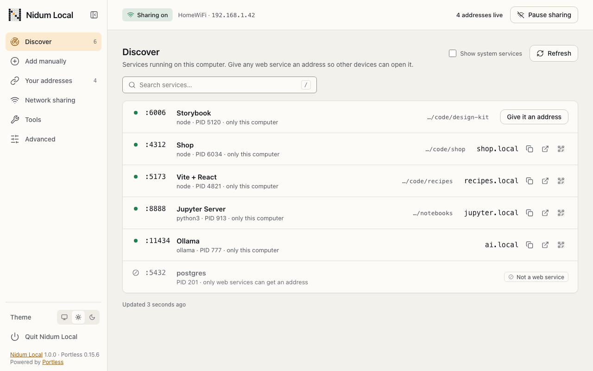
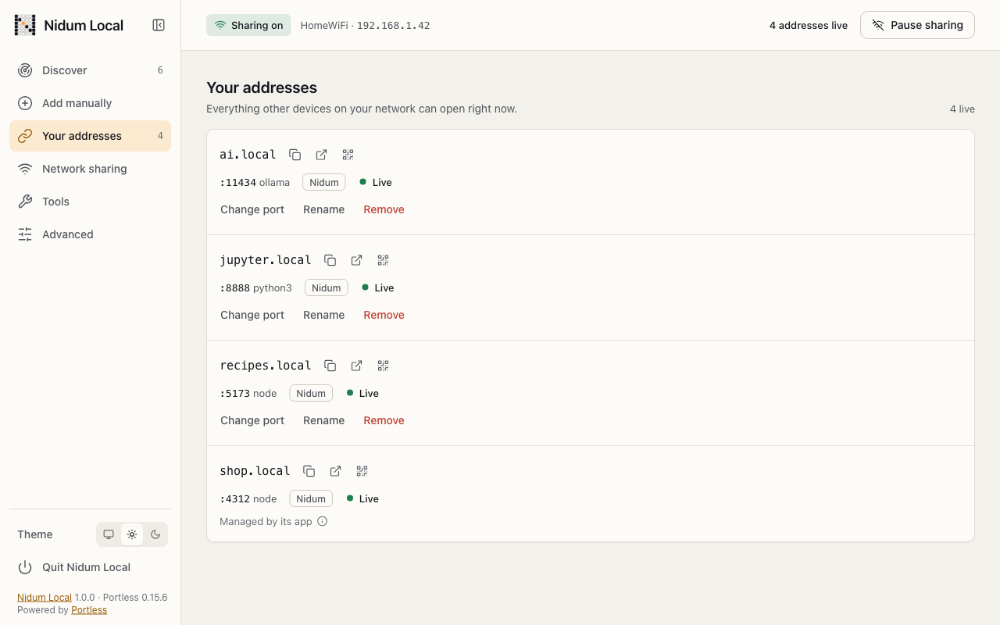
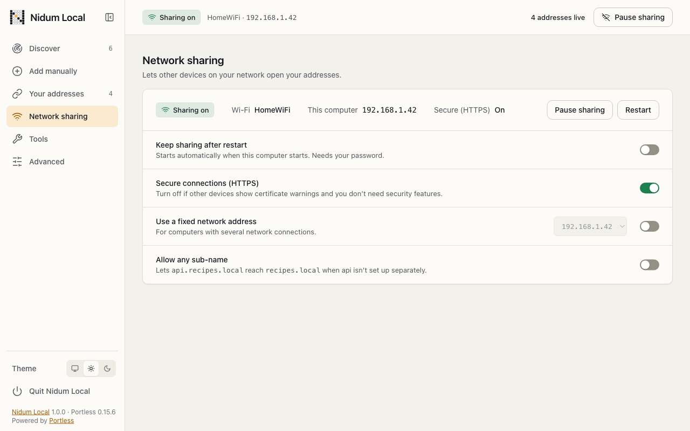
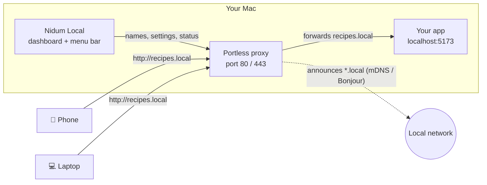

<div align="center">

<picture>
  <source media="(prefers-color-scheme: dark)" srcset="assets/brand/nidum-chips-lockup-dark.svg">
  
</picture>

### Share what's running on your Mac with every device on your network.

**`localhost:5173` → `http://recipes.local`, on your phone, your tablet and your teammate's laptop, in one click.**

[](#quick-start)
[](https://nodejs.org)
[](https://github.com/vercel-labs/portless)
[](package.json)
[](#privacy-and-security)
[](https://nidum.ai)

[Quick start](#quick-start) · [Features](#features) · [How it works](#how-it-works) · [Menu bar app](#menu-bar-app) · [For teams](#nidum-for-your-company) · [Development](#development)

<br>

<picture>
  <source media="(prefers-color-scheme: dark)" srcset="assets/screenshots/discover-dark.png">
  
</picture>

</div>

---

## Why Nidum Local?

You're running something great on your Mac: a Vite app, a Jupyter notebook, a local AI model, Plex, a Storybook. Now you want to open it on your phone, show it to someone across the room, or point another machine at it.

Normally that means finding your IP address, remembering port numbers, fighting `localhost` bindings and typing `http://192.168.1.42:5173` into a tiny keyboard.

**Nidum Local turns that into a name.** It finds what's running, lets you give it an address like `recipes.local`, and shares it on your local network with a QR code ready to scan. No cloud, no account, no tunnel, no config files.

## Features

|  |  |
| --- | --- |
| 🔎 **Discover** | Sees every service listening on your Mac, knows which ones are web apps, and names them for you (Storybook, Vite + React, Jupyter, Ollama…). |
| 🏷️ **One-click addresses** | *Give it an address* turns `:5173` into `recipes.local`. Or add any port by hand. |
| 📱 **QR codes** | Every address has a QR code, so opening it on a phone is point-and-tap. |
| 🟢 **Live status** | Each address shows whether its app is up, starting or stopped. It also flags frameworks that block unknown host names, like Vite's `allowedHosts`, and tells you the fix. |
| 🔒 **HTTPS when you want it** | Secure `.local` addresses, plus guided device setup for phones and other computers. |
| ⏸️ **Pause and resume** | Take everything offline in one click, and bring it back just as fast. |
| 🔁 **Keeps running** | Optionally keep sharing after a restart, as a startup service. |
| 🧭 **Network-aware** | Shows the Wi-Fi or Ethernet you're on, warns you on public networks, and can pin a fixed network address. |
| 🩺 **Plain-language fixes** | When something's wrong, such as a locked address list, a missing tool or a service that won't start, it says what happened and what to do, with copy-ready commands. |
| 🌗 **Light and dark** | Follows your system, or pick one. |
| 🍎 **Menu bar app** | Open Dashboard, Stop All Services, Quit: always one click away. |

<table>
  <tr>
    <td width="50%">
      <picture>
        <source media="(prefers-color-scheme: dark)" srcset="assets/screenshots/addresses-dark.png">
        
      </picture>
      <p align="center"><b>Your addresses</b>: what other devices can open right now</p>
    </td>
    <td width="50%">
      <picture>
        <source media="(prefers-color-scheme: dark)" srcset="assets/screenshots/sharing-dark.png">
        
      </picture>
      <p align="center"><b>Network sharing</b>: one place for every switch</p>
    </td>
  </tr>
</table>

## Quick start

**You need:** a Mac (macOS 13 or later). Nidum Local checks for [Node.js](https://nodejs.org) 18+ and [Portless](https://github.com/vercel-labs/portless), and **asks before installing anything**.

```bash
git clone https://github.com/junainfinity/nidum-local.git
cd nidum-local
open "Nidum Local.command"
```

Or double-click **`Nidum Local.command`** in Finder. The first time, macOS may ask you to allow it: go to **System Settings → Privacy & Security** and click **Open Anyway**.

The launcher then:

1. checks Node.js and Portless (and offers to install what's missing),
2. turns on network sharing if it's off (your Mac asks for your password),
3. opens the dashboard in your browser,
4. starts the menu bar app.

Open the dashboard, pick a service in **Discover**, click **Give it an address**, and scan the QR code with your phone. That's it.

> **Tip:** from another device, use the name, not the port. `http://ai.local/v1` works across the network; `http://192.168.1.42:11434` only works if that app itself listens beyond `localhost`.

<details>
<summary><b>Windows and Linux (experimental)</b></summary>

- **Windows:** open `launchers\windows` and double-click `Nidum Local.cmd`.
- **Linux:** run `launchers/linux/nidum-local.sh` in a terminal.

These launchers are tested against fixtures only. macOS is the verified platform.

</details>

## How it works



- **[Portless](https://github.com/vercel-labs/portless)** does the networking. It runs a small proxy on port 80 (or 443 for HTTPS), maps names like `recipes.local` to local ports, and announces them on your network over mDNS, the same Bonjour that AirDrop and AirPlay use.
- **Nidum Local** is the friendly layer on top: discovery, naming, live health checks, QR codes, HTTPS device setup, startup service, pause/resume, and clear explanations when something needs your attention.
- Your apps keep running exactly as they are, on `localhost`. Nothing about them changes.

## Menu bar app

A native macOS menu bar app (no Dock icon) with exactly three items:

- **Open Dashboard**: starts the dashboard if needed and opens it.
- **Stop All Services**: takes every address offline (asks for your password if your setup needs it).
- **Quit**: stops sharing, then quits Nidum Local.

It's built from Swift source on first launch (about 5 seconds), and its icon adapts to light and dark menu bars.

## Privacy and security

- **Local only.** No cloud service, no account, no telemetry. Traffic goes straight from your devices to your Mac over your own network.
- **Locked-down dashboard.** It listens on `127.0.0.1` only, behind a per-session token, with a strict Content-Security-Policy and same-origin checks on every change.
- **You stay in control.** Anything that needs administrator rights shows your Mac's own password dialog, with a plain description of the action.
- **Public network warning.** Nidum Local warns you when you're on a network that looks public (hotel, airport, guest Wi-Fi), because anyone on it could open your addresses.
- **Your files are respected.** If your address list is locked or read-only, Nidum Local explains how to fix it rather than overriding it.

## Nidum for your company

<table>
  <tr>
    <td>
      <h3>🚀 Want this setup for your team?</h3>
      <p>We help companies run <b>local-first, private infrastructure</b>: sharing internal tools and dashboards across the office, serving <b>on-prem AI models</b> to every desk, and making developer machines reachable safely, all without sending data to the cloud.</p>
      <p>
        <b>📧 <a href="mailto:info@quantellics.com?subject=Nidum%20Local%20for%20our%20company">info@quantellics.com</a></b>
        &nbsp;·&nbsp; 🌐 <a href="https://nidum.ai">nidum.ai</a>
      </p>
      <p><sub>Tell us about your team and what you'd like to share. We'll get back to you.</sub></p>
    </td>
  </tr>
</table>

## Development

```bash
npm start                 # run the dashboard server directly (node src/server.js)
npm test                  # unit and UI tests (node:test, no dependencies)
NIDUM_E2E=1 npm run test:e2e   # end-to-end scenarios against an isolated Portless
```

| Folder | What's inside |
| --- | --- |
| `src/` | Server, API, Portless adapter, port discovery, network detection |
| `public/` | The dashboard (plain ES modules, no build step) |
| `launchers/` | macOS launcher (plus experimental Windows and Linux) |
| `macos/menubar/` | The Swift menu bar app |
| `scripts/` | Menu bar build and release packaging |
| `test/` | Unit, UI (headless Chrome) and end-to-end tests |
| `design/` | Design tokens and reference boards |

**Requirements for development:** Node.js 22+ for the test tooling (the app itself runs on Node.js 18+), Google Chrome for the UI tests, and Xcode command-line tools (`swiftc`) for the menu bar app.

**Safety guard.** The end-to-end tests never touch your real Portless setup: they run against a throw-away, isolated proxy. A guard fingerprints your real state before and after. Record it once with `mkdir -p docs && npm run guard:record`, then `npm run guard:check` confirms nothing changed.

**Packaging:** `scripts/package.sh` builds a release zip with the prebuilt menu bar app.

## Credits

- Built on **[Portless](https://github.com/vercel-labs/portless)** by Vercel Labs, which does the proxying and `.local` naming.
- Made by **[Nidum.ai](https://nidum.ai)**.

<div align="center">
<br>
<picture>
  <source media="(prefers-color-scheme: dark)" srcset="assets/brand/nidum-chips-mark-dark.svg">
  
</picture>
<br>
<sub><b>Nidum Local</b> · your Mac, on every screen in the room.</sub>
</div>
